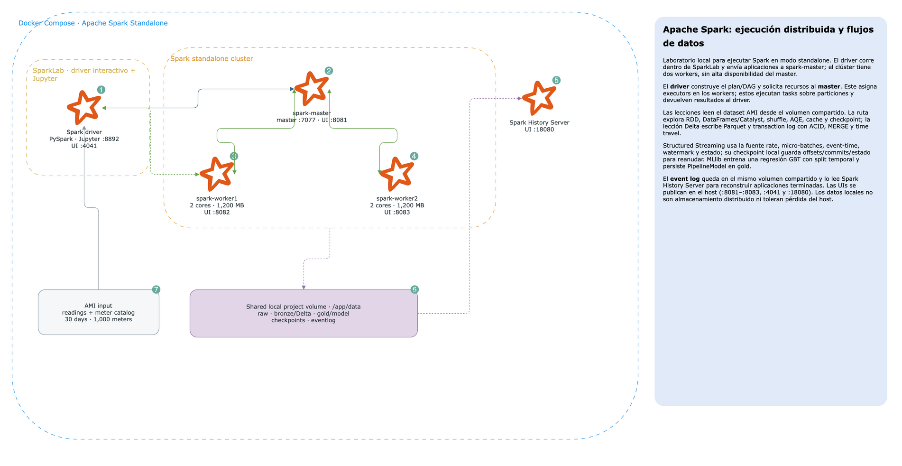

# Spark Processing Architecture

Laboratorio dedicado a entender **Apache Spark como motor distribuido**: ejecución en clúster standalone, driver y
executors, RDDs, DataFrames y Catalyst, shuffle, particionamiento, AQE, persistencia, Delta Lake, Structured Streaming,
MLlib, tolerancia a fallos y Spark History Server.

El dataset es sintético y reproducible: 1.000 medidores inteligentes, 30 días de lecturas de energía, catálogo por
ciudad y datos con anomalías.

## Arquitectura



Diagrama editable: [`docs/architecture.drawio`](docs/architecture.drawio).

| Servicio | Rol |
| --- | --- |
| `spark-master` | Asigna executors en el clúster standalone; UI en `:8081` |
| `spark-worker1`, `spark-worker2` | Dos workers, 2 cores y 1.200 MB cada uno |
| `spark-lab` | Driver interactivo, PySpark, CLI y JupyterLab |
| `spark-history` | Reconstruye las Spark UIs desde event logs persistidos |

El dataset y los resultados se comparten mediante el volumen del proyecto. Es almacenamiento local compartido; las
lecciones se concentran en el motor Spark.

## Requisitos y arranque

- Docker Desktop con Compose y 6 GB o más disponibles; se recomienda 8 GB si VS Code/Jupyter estarán abiertos.
- Puertos libres: `7077`, `8081`–`8083`, `8892`, `18080`, `4041`.

Desde `.docker/`:

```bash
docker compose up -d --build
docker exec SparkLab python lessons/00_seed.py
```

Abre JupyterLab en `http://localhost:8892`. El código se puede correr también desde una terminal en `SparkLab`:

```bash
python lessons/01_execution_model.py
python lessons/02_spark_sql_catalyst.py
# seguir en orden hasta lessons/10_history_server.py
```

| UI | URL |
| --- | --- |
| Master | `http://localhost:8081` |
| Worker 1 / 2 | `http://localhost:8082` / `http://localhost:8083` |
| Aplicación Spark activa | `http://localhost:4041` |
| History Server | `http://localhost:18080` |
| JupyterLab | `http://localhost:8892` |

Detén el laboratorio sin borrar los datos con `docker compose stop` desde `.docker/`. Los artefactos locales se guardan
en `data/`; `python lessons/00_seed.py` regenera el origen.

## Lecciones

| # | Tema | Conceptos observables |
| --- | --- | --- |
| 00 | Dataset | Semilla sintética reproducible |
| 01 | Modelo de ejecución | Driver, master, workers, ejecutores, RDD, DAG, stages y tasks |
| 02 | Spark SQL | Catalyst, schema, predicate pushdown y column pruning |
| 03 | Particiones | Narrow/wide, shuffle, repartition, coalesce y skew |
| 04 | AQE y joins | Broadcast vs. sort-merge y plan adaptativo |
| 05 | Persistencia | Cache, storage levels, lineage y checkpoint |
| 06 | Delta Lake | ACID log, schema enforcement, MERGE y time travel |
| 07 | Structured Streaming | Micro-batches, event time, watermark, estado y checkpoint |
| 08 | MLlib | Pipeline, split temporal, GBT, RMSE y R² |
| 09 | Recuperación | Fallo simulado de task y reintento por lineage |
| 10 | History Server | Event logs y diagnóstico post-mortem |

## Estructura

```text
.docker/       Dockerfile, Compose y configuración Spark
data/          datos de entrada, lake, checkpoints y event logs (generado)
docs/          diagrama editable
lessons/       lecciones ejecutables
notebooks/     sandbox
src/lab/       dataset y utilidades compartidas
```

El clúster es didáctico, no de producción: standalone sin HA del master, datos locales compartidos y sin autenticación
TLS/Kerberos. `spark.task.maxFailures` demuestra reintentos; no implica tolerancia a la pérdida simultánea del master.
